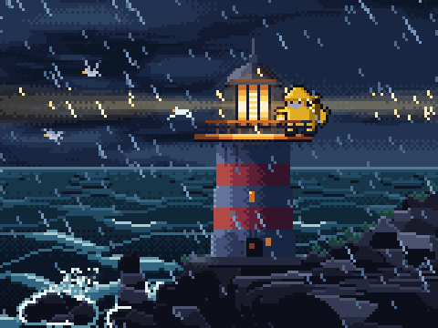
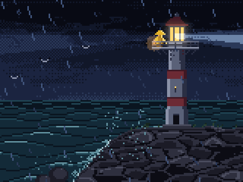
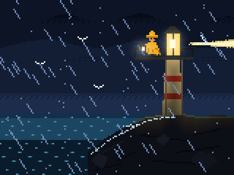
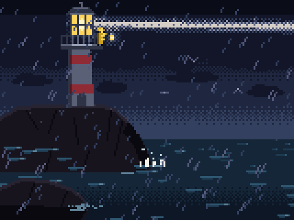
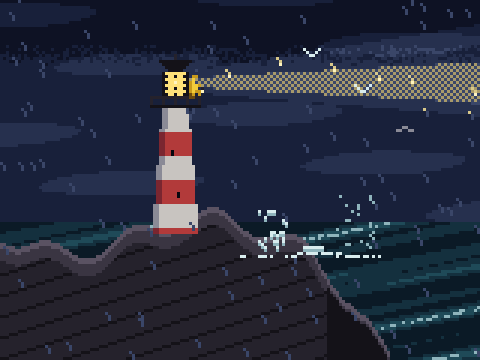

# Which model, how much effort: one scene, eight ways

One brief given to eight fresh agents with the pxl skill, each on a different model or effort level,
to see what more thinking buys in pixel art and what it costs. Run on 2026-10-21 with Claude Code;
every number below comes from the runs themselves (Claude Code's result for each session, its
transcript read by [`scripts/tokens.ts`](../scripts/tokens.ts)), and the art was judged blind.

**In short:** on Opus, the art got better from low effort to high and then stopped getting better,
while the cost doubled at every step. High was the best value: the top score at half the cost of
xhigh and a quarter of max. Sonnet at xhigh cost as much as Opus at high and scored lower; Haiku was
the cheapest by far and got the scene's space wrong; Fable at high cost more than Opus at high and
scored lower. One run each, one brief: read the numbers as a first measure, not a law.

## Contents

- [The brief](#the-brief)
- [How it was run](#how-it-was-run)
- [The results](#the-results)
- [The art](#the-art)
- [What the numbers say](#what-the-numbers-say)
- [Where the tokens went](#where-the-tokens-went)
- [What to use](#what-to-use)
- [What this doesn't show](#what-this-doesnt-show)
- [Doing it again](#doing-it-again)

## The brief

A new scene, like none of the examples, that asks for light, weather, a character at a small scale
and a loop ([`study/lighthouse/brief.txt`](study/lighthouse/brief.txt), word for word):

> a 160x120 animated pixel-art scene: a lighthouse on a rocky headland on a stormy night. The lamp's
> beam sweeps through the slanting rain; waves break on the rocks below and throw up spray; a keeper
> in a yellow oilskin stands on the gallery holding a lantern, the coat flapping in the wind; a few
> gulls struggle against the wind. The lamp is the light: say where it comes from. Loop it
> seamlessly. Original art. > Work until you would show it to a pixel-art curator, then reply with
> the art file's path, the scene's name, and two lines on what you'd improve next.

Each agent was told to use the pxl skill, to keep its files in its own folder, not to spawn agents
and not to ask questions.

## How it was run

Eight headless Claude Code sessions, one per configuration, each in an empty folder, with the skill
as it is installed (the skill folder links to this repository, so they all read the same
`SKILL.md`):

```sh
claude -p --model <haiku|sonnet|opus|fable> --effort <low|medium|high|xhigh|max> --output-format json \
  --allowedTools "Bash Read Write Edit Glob Grep Skill" < brief.txt > result.json
```

([`scripts/model-study.sh`](../scripts/model-study.sh) runs one.) Four ran at a time on one laptop,
with no budget and no time limit. The models were `claude-haiku-5-5`, `claude-sonnet-5-5`,
`claude-opus-5-5` and `claude-fable-5-1`. Each scene was then checked (`pxl check`), read back (`pxl
study`, for its loop) and judged blind (below).

## The results

| Model | Effort | Turns | Time | Cost | Output (of it thinking) | Cache reads | Made as | Loop | Blind score | Rank |
|---|---|---:|---:|---:|---:|---:|---|---|---:|---:|
| Opus | low | 14 | 2 min | $0.54 | 7k (1k) | 0.6M | one `anim` | 32 frames, closes | 3 | 8 |
| Opus | medium | 42 | 9 min | $2.17 | 41k (19k) | 3.1M | scene | 64, closes | 5 | 5 |
| Opus | high | 75 | 22 min | $4.71 | 82k (45k) | 9.2M | scene | 96, closes | **7** | 2 |
| Opus | xhigh | 122 | 34 min | $9.62 | 172k (119k) | 20.3M | scene | 96, closes | **7** | **1** |
| Opus | max | 187 | 68 min | $20.01 | 310k (223k) | 50.6M | scene | 96, closes | 6 | 3 |
| Sonnet | xhigh | 100 | 31 min | $5.32 | 206k (151k) | 20.5M | scene | 48, closes | 6 | 4 |
| Haiku | xhigh | 45 | 9 min | $0.37 | 87k (70k) | 3.7M | one `anim` | 40, closes | 4 | 6 |
| Fable | high | 41 | 17 min | $7.05 | 68k (33k) | 4.2M | scene | 60, closes | 4 | 7 |

Turns, cost and tokens are Claude Code's own figures for each session (cost at list prices); time is
the wall clock, four sessions sharing the machine. Every scene loops without a jump (`pxl study`:
"the last frame runs into the first") and `pxl check` finds no warnings in any of them; but the two
made as one `anim` drawn in code give `check` nothing to check, where the six scenes ran its
lit-side rule on every placement.

**The blind review.** A separate agent (Opus, at its default effort) was shown each scene as eight
frames spread over its loop, labeled A to H in a shuffled order, with the brief, and scored each 1
to 5 on five criteria, then 1 to 10 overall. It knew nothing of the models or the costs. Its scores:

| Entry | Reads at a glance | The light | The storm | The keeper | Craft | Overall |
|---|---:|---:|---:|---:|---:|---:|
| Opus xhigh | 4 | 3 | 4 | 3 | 4 | 7 |
| Opus high | 4 | 4 | 3 | 2 | 4 | 7 |
| Opus max | 4 | 4 | 3 | 2 | 4 | 6 |
| Sonnet xhigh | 3 | 3 | 5 | 2 | 3 | 6 |
| Opus medium | 4 | 2 | 3 | 3 | 3 | 5 |
| Haiku xhigh | 3 | 1 | 4 | 3 | 3 | 4 |
| Fable high | 3 | 3 | 2 | 2 | 3 | 4 |
| Opus low | 3 | 3 | 2 | 1 | 2 | 3 |

<details><summary>The reviewer's brief</summary>

> You are a pixel-art curator judging eight entries made from the same brief. You don't know who
> made them or how; judge only what you see. [the brief] Each image shows 8 frames of one entry,
> spread evenly over its loop, at 2x, in two rows of four. Score each entry 1 to 5 on each
> criterion, with one short reason per score: 1. Reads at a glance: composition, focal point,
> silhouettes. 2. The light: the lamp as the source, the beam's sweep (a lighthouse beam turns about
> a vertical axis: it should never point down into the rock or straight up), how it lights the rain
> and the scene. 3. The storm: slanting rain, waves, spray breaking on the rocks. 4. The keeper: on
> the gallery, yellow oilskin, lantern, coat flapping; at the right scale for the tower (a person
> must fit its door and its rail). 5. Craft: clean pixel work, palette, readable details, no muddy
> noise. Then: an overall score 1-10, the entry's biggest strength and its biggest flaw in one line
> each. Finish with a ranking from best to worst.

</details>

## The art

Each at 3× (`pxl build --share 3`), best first by the blind ranking. The sources are in
[`study/lighthouse/src/`](study/lighthouse/src).

**Opus, xhigh** ($9.62): every part of the brief is there and reads: a stone headland with grass on
top, sea stacks, spray bursting on them, rain lit inside the beam, a keeper with a lantern at the
right size for the door and the rail. The beam turns in perspective, coming toward us; the reviewer
found it tilted too steeply, near pointing up.


**Opus, high** ($4.71): the most correct sweep (right, a glow as it faces us, left, dark), gulls lit
as the beam passes, a wave bursting into real spray against a rock. The keeper is a yellow speck,
right for the scale but hard to read, and the storm is quiet.


**Opus, max** ($20.01): the best beam of all, a wide soft cone with the rain glinting in it, and a
strong, gloomy mood; but darker and plainer than xhigh (an unstriped tower, a small keeper, modest
spray), and one frame aims the beam low.


**Sonnet, xhigh** ($5.32): the best storm, with heavy slanting rain, a white-capped sea and waves
breaking on the rocks, and rain lit yellow by the beam; but a keeper as big as the lantern room,
wider than the door, and a beam pointing straight up in one frame.



**Opus, medium** ($2.17): a good layout, the tower on the right third over a cobbled headland, the
keeper at the right size with a lantern glow; but the beam ends cut square in mid-air and the sea is
one repeating pattern.



**Haiku, xhigh** ($0.37): the best-read keeper (yellow, a glowing lantern) and good rain; but the
beam turns like a clock hand, down through the tower into the rock and straight up: the scene's
space was never worked out.



**Fable, high** ($7.05): a clean, simple sweep and some atmosphere (a haze at the horizon, a glow
round the lamp); but the tower is jammed into the top corner, the headland is a dark mass and the
storm is weak, the spray a tiny crown.



**Opus, low** ($0.54): done in 14 turns and two minutes, a clear silhouette and a horizontal sweep;
but flat rendering (a rock filled with hatching, a harsh checkerboard beam) and a keeper of two or
three pixels.



## What the numbers say

- **On Opus, quality rises to high and then stops; cost doubles at every step.** Low 3, medium 5,
  high 7, xhigh 7, max 6, for $0.54, $2.17, $4.71, $9.62 and $20.01. High scored as well as xhigh
  for half its cost, and better than max for a quarter.
- **More effort means more turns.** 14, 42, 75, 122, 187: a higher effort keeps the agent looking
  and fixing for longer more than it makes each turn deeper. Since every turn reads the whole
  conversation again, the cache reads grow faster still (0.6M to 50.6M), and the thinking from 1k
  tokens to 223k.
- **Max builds its own tools.** The max run wrote a script to apply its edits (rewritten 21 times
  instead of using the Edit tool), files for each section of the scene and a test for the beam's
  angle: process round the work, a part of what its 187 turns paid for.
- **The smaller models miss the scene's space.** Haiku turned the beam in the picture plane, into
  the rock; Sonnet drew the keeper bigger than the door and pointed the beam up. Both handled the
  parts that are flat on the picture well (rain, sea, a keeper that reads).
- **Sonnet at xhigh isn't cheaper than Opus at high.** It took 100 turns to Opus's 75 and cost $5.32
  to $4.71, for a lower score.
- **Fable costs the most per turn.** $7.05 for 41 turns and 68k tokens of output, where Opus at high
  cost $4.71 for 75 turns; it scored 4.
- **Low effort skips the structure.** Opus at low and Haiku drew the whole scene as one `anim` in
  code; the others made a scene of parts, which `pxl check` can read (the lit side of every
  placement against the lamp).

## Where the tokens went

Each session's transcript read by `scripts/tokens.ts` (cost in input-token units: an input token 1,
a cache write 1.25, a cache read 0.1, an output token 5):

| Run | Thinking, as output | Thinking kept and re-read, and cache rewrites | Tool results and what it wrote | The fixed context | Most re-read |
|---|---:|---:|---:|---:|---|
| Opus low | 16% | 35% | 10% | 28% | its one Write (39%) |
| Opus medium | 24% | 32% | 18% | 18% | `pxl help` (40%) |
| Opus high | 21% | 37% | 21% | 14% | `pxl help` (36%) |
| Opus xhigh | 23% | 47% | 17% | 9% | `pxl help` (32%) |
| Opus max | 19% | 52% | 20% | 6% | its own scripts, written and run (34%) |
| Sonnet xhigh | 26% | 47% | 16% | 8% | `pxl help` (24%) |
| Haiku xhigh | 40% | 35% | 11% | 9% | `pxl help` (61%) |
| Fable high | 28% | 31% | 18% | 14% | `pxl help` (35%) |

(What the agent wrote as output, 3-11%, makes up the rest.) The longer the session, the more of its
cost is thinking kept in the conversation and read again: 32% at medium, 52% at max. All eight
followed the skill's rules on reading and writing (from [the tokenomics
study](agents.md#what-it-costs)): each wrote its art file once and changed it with edits after
(three earlier sessions had written theirs whole ten times between them), and read the guides by
section through `pxl help`. The reference was still read in blocks with `sed` now and then: twice by
Sonnet and three times by Opus at max (about 3k tokens a block), once or twice in a few lines by
Haiku and Opus at high.

## What to use

- **A scene, one agent: Opus at high.** The best score for its cost here.
- **A draft, a small asset, a quick fix: Opus at medium.** A good layout at under half the cost of
  high, with flaws a round of notes can fix.
- **xhigh when completeness matters** and twice the cost of high is fine: it was the only run with
  every part of the brief readable.
- **Not max for art.** Twice the cost of xhigh and four times high, for a lower score.
- **Opus over Sonnet, Haiku and Fable for scenes** with space in them (a beam that turns,
  perspective, scale against a door): the smaller models got the flat parts right and the space
  wrong, and Fable scored lower at a higher price.
- **A pipeline's parts** (docs/agents.md) at medium or high each, the planner at high.

With Claude Code: `claude --model opus --effort high`, or `/model` and `--effort` for a session.

## What this doesn't show

- **One run each.** The same configuration run again draws something else; a score of 7 against 6 is
  within what a second run could change. Repeat it before generalizing.
- **One brief.** A scene with space, light and weather; small sprites, tiles or a character sheet
  may favor the smaller models more.
- **One reviewer, from stills.** An Opus agent, blind to who made what, judging eight frames of each
  loop, not the motion; and a model may favor art made the way it would make it.
- **Wall times on a shared laptop.** Four sessions ran at once; the turns and the tokens are the
  fairer measure of effort.

## Doing it again

```sh
# each configuration in its own folder under runs/, four at a time
for c in "opus medium" "opus high" "sonnet xhigh" "haiku xhigh"; do
  scripts/model-study.sh docs/study/lighthouse/brief.txt runs $c &
done; wait
# where one session's tokens went (its transcript, by the session_id in result.json)
node scripts/tokens.ts ~/.claude/projects/<the run's folder>/<session_id>.jsonl
# its scene checked, and its loop read back
pxl check runs/opus-high/<file>.px.js
pxl study runs/opus-high/out/scenes/<scene>.gif --no-out
```
